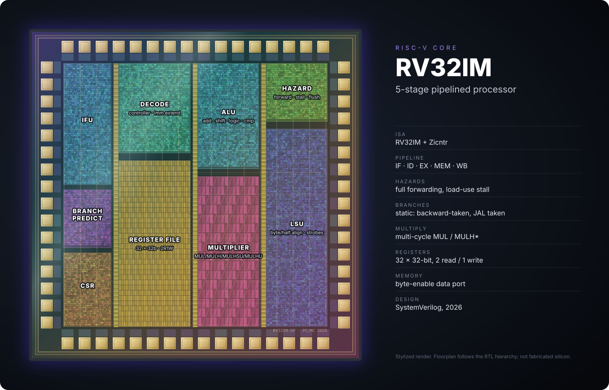

I'm an engineering student at Harvey Mudd College. I like working where hardware and software meet: designing digital logic, figuring out how processors work, and writing the low-level code that brings a board to life.

*A stylized render of the 5-stage RV32IM core my partner and I built, with each block mapped to a module in our RTL. [Read the writeup →](projects/soc-final/soc-final.qmd)*

## What I Study

### Computer Architecture

How processors are built and what makes them fast. For my System-on-Chip Design final project, my partner and I turned a single-cycle RISC-V core into a [5-stage pipelined processor](projects/soc-final/soc-final.qmd) and optimized it for speed and area. I've also worked on [RISC-V's debug trigger extension](posts/sdtrig-certification-tests.qmd), which adds hardware breakpoints and watchpoints to the architecture.

### Design & Verification

Writing SystemVerilog and proving it works with simulation, compliance tests, and benchmarks. As a Clay-Wolkin Research Fellow, I [write certification tests for RISC-V Sdtrig](posts/sdtrig-certification-tests.qmd), and I've found and reported bugs in a RISC-V reference simulator along the way.

### Embedded Systems

Register-level microcontroller programming and real peripherals. In Microprocessor-based Systems (E155), I've used an iCE40 FPGA and an STM32L432KC to build a [keypad scanner](labs/lab3/lab3.qmd), [digital audio](labs/lab4/lab4.qmd), and a [Wi-Fi temperature monitor](labs/lab6/lab6.qmd) over SPI.

### Industry Hardware

At TRL11, I worked on space-qualified networking hardware.

## On This Site

[Labs](labs.qmd) has write-ups for my E155 labs, [Projects](projects.qmd) has larger builds, and the [Blog](blog.qmd) has posts about my work.
