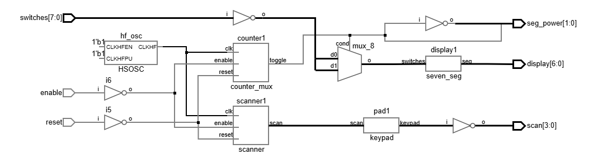
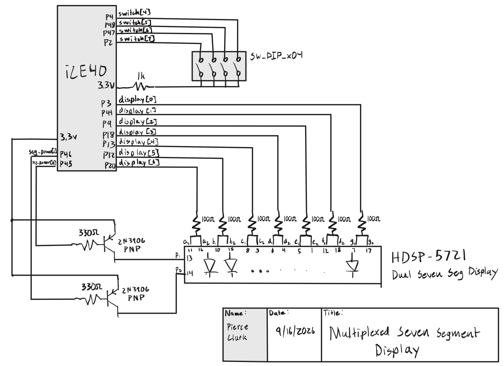
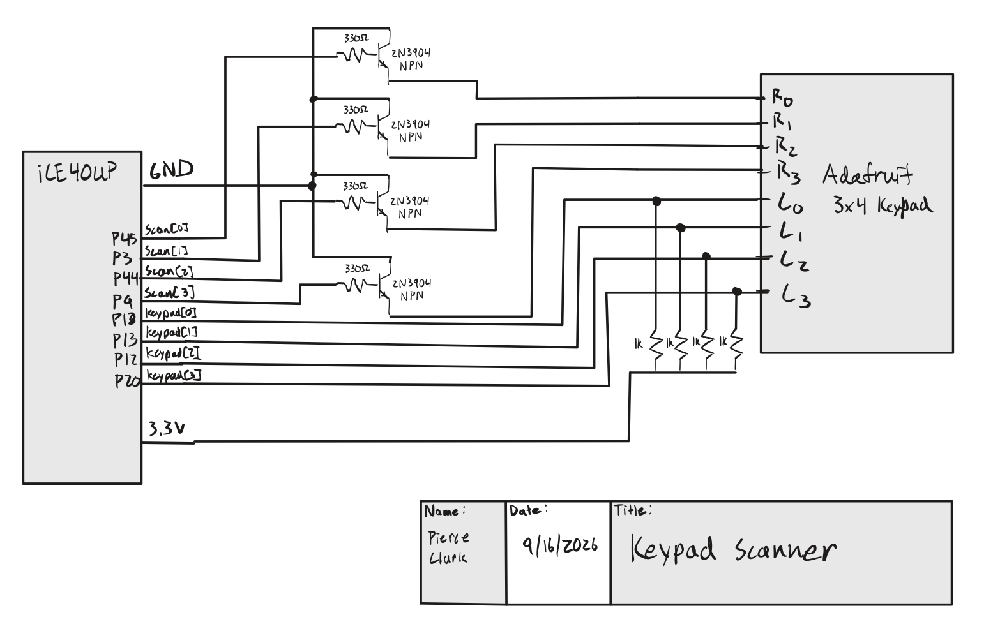
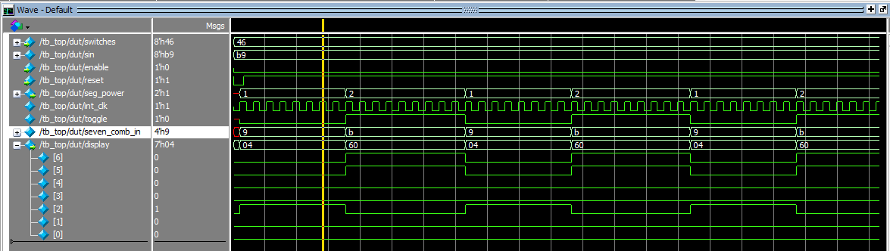
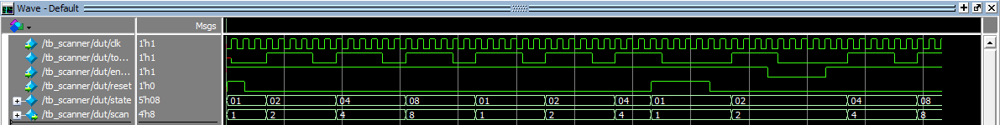

## Introduction

In this lab, a design was implemented on the Lattice iCE40 UP5K to practice designing sequential circuits and use transistors. Two independent
hexadecimal digits were displayed on a dual seven segment display using a single decoder
module and time multiplexing. A scanning module driven at 8 Hz swept the keypad rows
and read the columns, lighting on-board LEDs to indicate which keys were pressed.

## Design and Testing Methodology

### Time Multiplexed Display

The on-board high-speed oscillator (HSOSC) from the iCE40 UltraPlus primitive library was used to generate a clock signal at 48 MHz. A counter was used to divide the high frequency clock signal down to 100hz. That  blinking frequency was used to toggle the power between the seven segment displays. The design was tested using an automatic test bench to demonstrate that the correct signal was passed when the display was flipped between digits.

### Keypad Scanner

The on-board high-speed oscillator (HSOSC) from the iCE40 UltraPlus primitive library was used to generate a clock signal at 48 MHz.  counter was used to divide the high frequency clock signal down to 8hz, and toggle a 4-state FSM such that each state was entered twice a second (2hz). The keypads output was read using inputs and then inverted due the active low behavior of the keypad.

### Testing

Testbenches were written for the scanner and top level module to demonstrate that the state transitions happened correctly. The oscilliscope was also used to verify the circuitry performed as expected.

## Technical Documentation

The source code for the project can be found in the associated [Github repository](https://github.com/pclarkhmc/e155).

### Block Diagram

<details>
<summary>Show block diagram</summary>



</details>

The block diagram in Figure 1 shows the overall architecture of the design. The top level module includes 3 submodules which contain the HSOSC, counter with muxing logic, scanner module, and display logic.

### Schematic

<details>
<summary>Show seven segment display schematic</summary>



</details>

Figure 2 shows the physical layout. The display is powered from 2 PNP transistors from the 3.3 V pin. The FPGA pins toggle between these power pins, and ground each segment to light it. 100 Ω resistors limit the seven-segment current, keeping both within the FPGA I/O and display ratings.

<details>
<summary>Show keypad scanner schematic</summary>



</details>

Figure 2 shows the physical layout. The display is powered from the 3.3 V pin, and the FPGA pins ground each segment to light it. 1 kΩ series resistors limit the on-board LED currents, and 150 Ω resistors limit the seven-segment current, keeping both within the FPGA I/O and display ratings.

### Display Current and Segment Resistor Calculations

The display is an HDSP-5721, a two digit common anode seven segment display. Its [datasheet](https://docs.broadcom.com/doc/AV02-1107EN)
has a typical forward voltage of $V_F = 2.0\text{ V}$ per segment at 20 mA.

Each segment is in series between the anode and an FPGA pin, with a
$100\,\Omega$ series resistor. The segments are driven from 3.3 V through a 2N3906 PNP transistor.  The equation for the circuit is $V_{cc} = V_{EC(sat)} + V_F + I_F R$. Taking
$V_{BE(sat)} = 0.25\text{ V}$ for the 2N3906, $V_F = 2.0\text{ V}$ leaves 1.05 V across the resistor:

$$
I_F = \frac{V_{cc} - V_{BE(sat)} - V_F}{R}
    = \frac{3.3 - 0.25 - 2.0}{100\,\Omega}
    = \frac{1.05\text{ V}}{100\,\Omega} = 10.5\text{ mA}
$$

Because the two digits are time multiplexed, each segment is lit for half of each multiplexing period, so the average current per segment is $I_{avg} = I_F / 2 = 5.25\text{ mA}$. This is under the max current rating of the anode.

### PNP Anode Driver Calculations

Each common anode is switched by a 2N3906 PNP. The emitter is 3.3 V, the collector drives one digit. The base is driven by a $330\,\Omega$
resistor from an FPGA pin. 

If all seven segments are lit at once, the total current drawn is 73.5 mA, which is less than the maximum 200mA Continuous Collector Current.

$$
I_C = 7 \times 10.5\text{ mA} = 73.5\text{ mA}
$$

With an emitter-base saturation voltage of $V_{EB(sat)} = 0.8\text{ V}$, the base current is

$$
I_B = \frac{V_{cc} - V_{BE(sat)}}{R_B}
    = \frac{2.5\text{ V}}{330\,\Omega} = 7.6\text{ mA}
$$

### NPN Open Drain Keypad Driver Calculations

Each row is driven through a 2N3904 NPN. The emitter is grounded, the collector drives the row, and the base is driven through a
$470\,\Omega$ resistor from an FPGA pin.

With $V_{OH} = 3.3\text{ V}$ and $V_{BE(sat)} = 0.8\text{ V}$, the base current is

$$
I_B = \frac{V_{OH} - V_{BE(sat)}}{R_B}
    = \frac{2.5\text{ V}}{470\,\Omega} = 5.3\text{ mA}
$$

## Results and Discussion

### Testbench Simulation

<details>
<summary>Show top level simulation</summary>



</details>

Figure 4 shows the QuestaSim results for the top level testbench. The display signals can be seen toggling between the switch inputs which confirms that the module functions as expected.

<details>
<summary>Show scanner simulation</summary>



</details>

Figure 5 shows the QuestaSim results for the keypad scanner testbench. The counter in the testbench was given a short cycle length so the full rotation is visible in simulation instead of taking the four seconds it would on
the board at 2 Hz per bit.

### Shortcomings

I fell short on the transistor calculations. I don't totally understand how transistors work. I had to ask for help on what values to use.

## Conclusion

This lab took approximately 15 hours.

## Lab 2 AI Prototype

As part of this lab, an AI coding assistant was prompted twice to generate a time
multiplexed seven segment display: once with no context, and once with the Lab 1 source
files attached to the conversation. The model used was Claude Opus 5. Both conversations
used the same wording apart from the sentence asking the model to reuse the attached
files, and each was run in a fresh conversation so that nothing carried over between them.

### Task 1: No Context

<details>
<summary>Show prompt and generated code</summary>

**Prompt:**

> Write SystemVerilog HDL to time multiplex a single seven segment decoder (that decodes
> from four bits to a common anode seven segment display) to decode two sets of input bits
> and drive two sets of seven output bits.

**Response:**

A single decoder is shared by muxing its 4-bit input between the two digits and demuxing
its 7-bit output back into two registers. A counter divides the input clock down to the
refresh rate and toggles a `sel` bit; `sel` chooses which nibble is presented to the
decoder and which output register captures the result. The decoder is active low, since a
common anode display lights a segment when its cathode is pulled low, and the segment
order is `{g,f,e,d,c,b,a}`. `CLK_FREQ_HZ` and `REFRESH_HZ` are parameters so the divider
can be retargeted, and `$clog2` sizes the counter automatically.

```systemverilog
module time_mux_seven_seg #(
    parameter int CLK_FREQ_HZ = 50_000_000,  // input clock frequency
    parameter int REFRESH_HZ  = 500          // per-digit refresh rate
) (
    input  logic       clk,
    input  logic       rst_n,
    input  logic [3:0] digit0,   // first set of input bits
    input  logic [3:0] digit1,   // second set of input bits
    output logic [6:0] seg0,     // first set of seven output bits
    output logic [6:0] seg1      // second set of seven output bits
);

    localparam int DIVISOR   = CLK_FREQ_HZ / (2 * REFRESH_HZ);
    localparam int CNT_WIDTH = $clog2(DIVISOR);

    logic [CNT_WIDTH-1:0] refresh_cnt;
    logic                 sel;      // 0 selects digit0, 1 selects digit1
    logic [3:0]           nibble;   // shared decoder input
    logic [6:0]           seg;      // shared decoder output

    // Refresh clock divider: toggles sel at 2 * REFRESH_HZ
    always_ff @(posedge clk or negedge rst_n) begin
        if (!rst_n) begin
            refresh_cnt <= '0;
            sel         <= 1'b0;
        end else if (refresh_cnt == CNT_WIDTH'(DIVISOR - 1)) begin
            refresh_cnt <= '0;
            sel         <= ~sel;
        end else begin
            refresh_cnt <= refresh_cnt + 1'b1;
        end
    end

    // Input mux: a single decoder is shared by both digits
    assign nibble = sel ? digit1 : digit0;

    // The one and only seven segment decoder, active low, ordered {g,f,e,d,c,b,a}
    always_comb begin
        unique case (nibble)
            4'h0: seg = 7'b1000000;
            4'h1: seg = 7'b1111001;
            4'h2: seg = 7'b0100100;
            4'h3: seg = 7'b0110000;
            4'h4: seg = 7'b0011001;
            4'h5: seg = 7'b0010010;
            4'h6: seg = 7'b0000010;
            4'h7: seg = 7'b1111000;
            4'h8: seg = 7'b0000000;
            4'h9: seg = 7'b0010000;
            4'hA: seg = 7'b0001000;
            4'hB: seg = 7'b0000011;
            4'hC: seg = 7'b1000110;
            4'hD: seg = 7'b0100001;
            4'hE: seg = 7'b0000110;
            4'hF: seg = 7'b0001110;
            default: seg = 7'b1111111;
        endcase
    end

    // Output demux: latch the decoder result into the digit that was selected
    always_ff @(posedge clk or negedge rst_n) begin
        if (!rst_n) begin
            seg0 <= 7'b1111111;
            seg1 <= 7'b1111111;
        end else if (sel) begin
            seg1 <= seg;
        end else begin
            seg0 <= seg;
        end
    end

endmodule
```

</details>

Read on its own, the module does what the prompt asked. One decoder instance is shared,
the mux and demux are driven by the same select bit, and the counter arithmetic is
correct. What it does not do is target this board. With no context the model assumed a
50 MHz clock arriving on an external `clk` pin, and the UP5K board used in this lab has no
such oscillator, so the design has no clock source until `HSOSC` is instantiated by hand.
It also assumed an asynchronous active low `rst_n`, which does not match the push button
the rest of the lab wires to a synchronous reset, and it invented its own
`{g,f,e,d,c,b,a}` segment encoding, which is bit reversed relative to the `seven_seg`
decoder written in Lab 1 and therefore relative to the pin assignments already in use.

Radiant results: TODO

### Task 2: With Lab 1 Files Attached

<details>
<summary>Show prompt and generated code</summary>

**Prompt:** (with `lab01_pc.sv`, `seven_seg.sv`, and `counter.sv` attached)

> Write SystemVerilog HDL to time multiplex a single seven segment decoder (that decodes
> from four bits to a common anode seven segment display) to decode two sets of input bits
> and drive two sets of seven output bits. Use the seven segment decoder and oscillator
> provided in the attached files.

**Response:**

The attached files already contain everything except the multiplexing, so this module is
mostly structural. `HSOSC` is instantiated exactly as it is in `lab01_pc.sv` to get the
48 MHz internal clock, the existing `counter` is reused as the refresh divider, and a
single `seven_seg` instance is shared between the two digits. Because `counter` drives its
`led` output high for the upper half of the count, it already produces a 50% duty square
wave that can be used directly as the select signal, so no extra toggle flop is needed. A
`maxcount` of 240,000 at 48 MHz gives a 5 ms period, refreshing each digit at 200 Hz.

```systemverilog
module seven_seg_mux(
	input  logic 		reset,
	input  logic [3:0] 	s0,		// first set of input bits
	input  logic [3:0] 	s1,		// second set of input bits
	output logic [6:0] 	seg0,	// first set of seven output bits
	output logic [6:0] 	seg1	// second set of seven output bits
);
	// 48 MHz internal oscillator, same instantiation as lab01_pc
	logic int_osc;
	HSOSC #(.CLKHF_DIV(2'b00))
		hf_osc (.CLKHFPU(1'b1), .CLKHFEN(1'b1), .CLKHF(int_osc));

	// Reuse the Lab 1 counter as the refresh divider.  Its led output is high
	// for the upper half of the count, so it is a 50% duty square wave.
	// 240,000 counts at 48 MHz is a 5 ms period, i.e. each digit is refreshed
	// at 200 Hz, which is well above the flicker threshold.
	logic select;
	counter #(32, 240000)
		refresh (.clk(int_osc), .reset(!reset), .enable(1'b1), .led(select));

	// Mux the two nibbles into the single shared decoder
	logic [3:0] nibble;
	assign nibble = select ? s1 : s0;

	// One instance of the Lab 1 seven segment decoder for both digits
	logic [6:0] seg;
	seven_seg decoder (.switches(nibble), .seg(seg));

	// Demux the decoder output back out to the two digits
	always_ff @(posedge int_osc) begin
		if (!reset) begin
			seg0 <= 7'b1111111;
			seg1 <= 7'b1111111;
		end else if (select) seg1 <= seg;
		else                 seg0 <= seg;
	end

endmodule
```

</details>

With the files attached the model stopped inventing infrastructure. It picked up the
`HSOSC` instantiation verbatim, including the `CLKHF_DIV(2'b00)` setting that yields
48 MHz, and it sized the refresh counter against 48 MHz rather than against the 50 MHz it
had guessed in Task 1. It reused `counter` and `seven_seg` by instantiation instead of
rewriting them, so the segment encoding is the same active low `{a,b,c,d,e,f,g}` mapping
the board is already wired for. It also noticed that `counter`'s `led` output is already a
50% duty square wave and used it directly as the select signal rather than adding a toggle
flop, which is a property of the attached file that Task 1 had no way to know about. The
one idiom it copied without adjusting is the reset: `.reset(!reset)` matches the call in
`lab01_pc.sv`, but the `always_ff` block in the same module tests `if (!reset)`, so the
reset polarity is inconsistent between the counter and the output registers.

Radiant results: TODO

Both generated files are kept verbatim, as generated, in the
[Github repository](https://github.com/pclarkhmc/e155) under
`lab02/fpga/src/ai_prototype/`.

### Reflection

I did not have much time to do the AI prototyping, but the code from task 2 looks much more compact than the code in part 1, which may indicate a better understand of the prompt and better efficiency.
