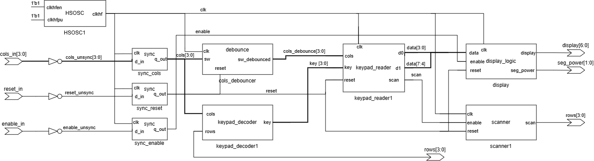
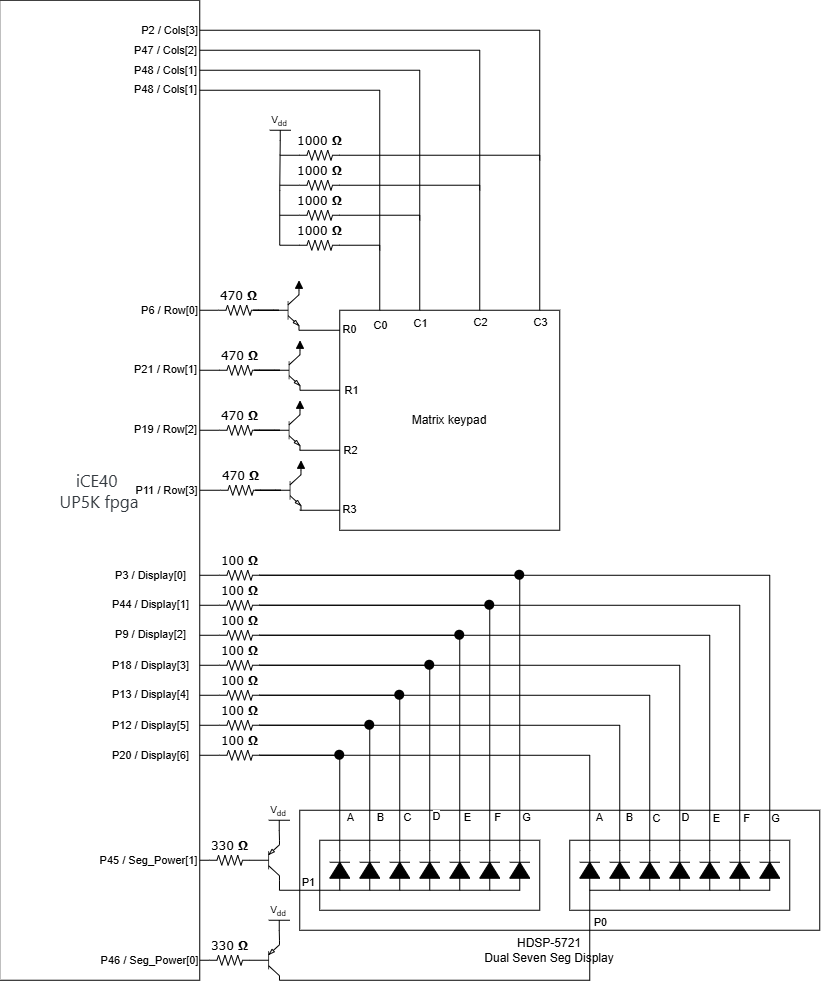
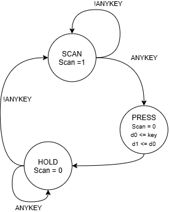
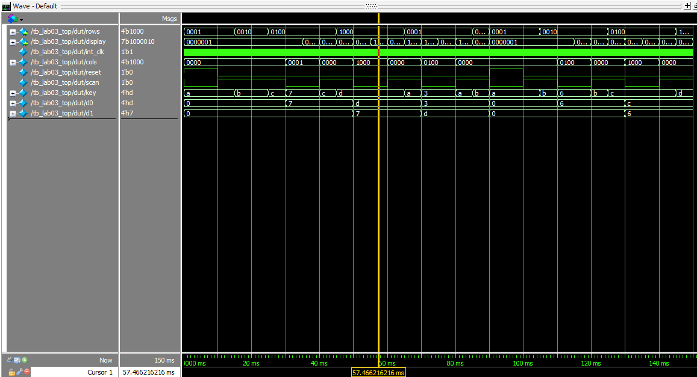
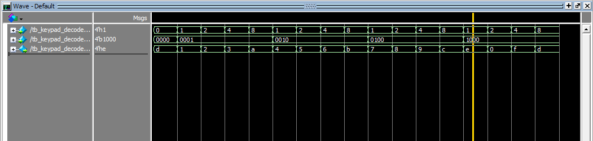
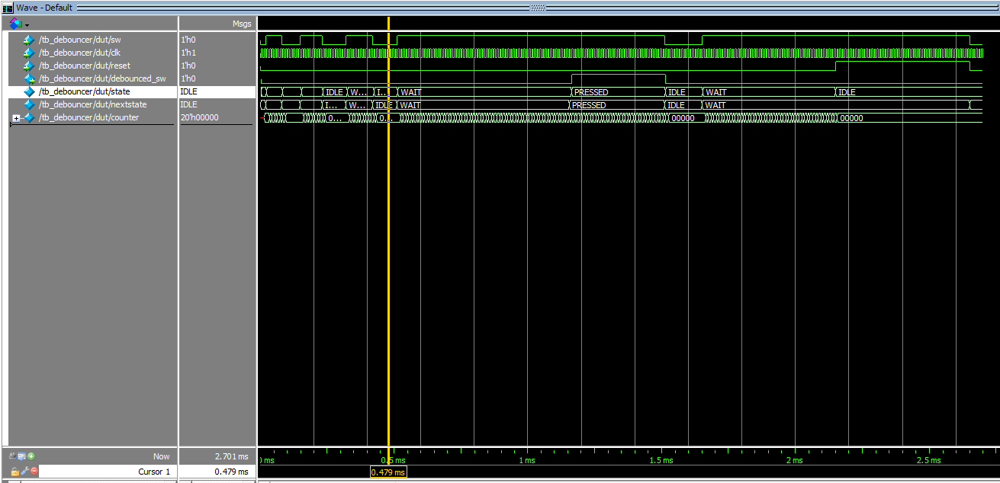
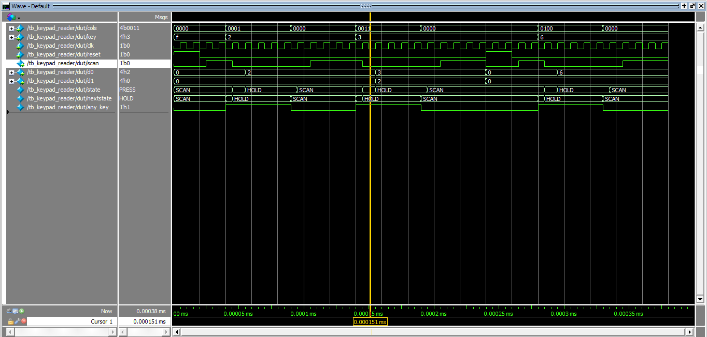
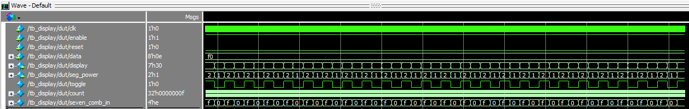
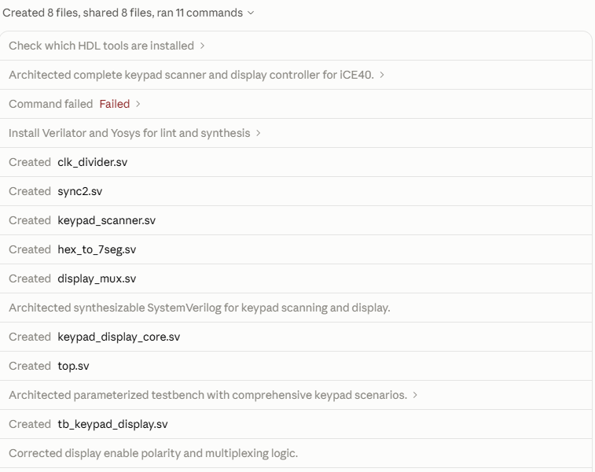
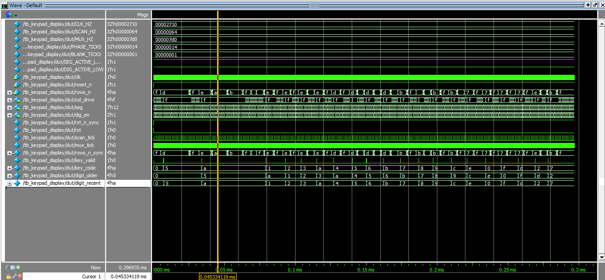

## Introduction

In lab 3, a keypad scanner feeding a time multiplexed dual seven segment display on the iCE40 UP5K fpga. When a new key is pressed on the keypad, the new key press shifts into the right digit, old digit shifts left. This lab helped build skills involing FSM design, synchronizing and debouncing inputs.

## Design and Testing Methodology

Input synchronizers were used on all outside inputs to the fpga (reset, keyboard columns). A debouncer fsm  waits for a set amount of time based on a variable flip_bit to debounce the 4 column signals from the keyboard. A scanner toggles rows to check for key presses using a 48 MHz HSOSC divided by 480,000.

A keypad decoder tells us what key is being pressed, and a keypad reader fsm determines when to update the display based on the keypad. The two digits are display on a reused module from Lab 2, which is multiplexed at 100 hz. Currently, no solution has been made to capture multiple key presses simultaineously, although solutions such as an additional state in the keypad reader have been proposed.

Each module that was not used in lab 2 has a testbench that expresses all FSM states or input to combinational logic.

## Technical Documentation

The source code for the project can be found in the associated [Github repository](https://github.com/pclarkhmc/e155).

### Block Diagram

{#fig-block}

In this diagram we can see the general layout of the circuit. Synchronizer modules are present on all inputs to the fpga. A debouncer is placed on the columns in order to prevent switch bouncing from the keyboard. The Keypad Decoder tell us what key is being pressed. While the Keypade Reader module choses when to update the display, and feeds the data to the display module.

### Schematic

{#fig-schematic}

In this schematic, we see the general circuit layout for the lab. The keyboard has pull-ups on the column inputs, and row drivers. The display transistors and resistors are also shown. The schematic for this lab is effectively the same as lab 2.

### State transition diagram

{#fig-fsm}

States:

SCAN: Allows the scanner to scan the rows until it detects a column pressed.

PRESS: The current key is stored in d0, and the old d0 goes to d1.

HOLD: Remains held until the all keys in the row are released.

### Calculations

The scanner goes to the next row once every 480,000 cycles of the 48 MHz HSOSC clock:

$$
f_{row} = \frac{48\text{ MHz}}{480{,}000} = 100\text{ Hz}
$$
$$
T_{row} = \frac{1}{100\text{ Hz}} = 10\text{ ms}
$$

Each row is driven for 10 ms before the scanner moves on. A 40 ms sweep is short compared to a typical human key press, so every press is seen on at least one full sweep.

The debounce time waits for $2^{17}$ cycles at 48 MHz, which equates to a wait time of 2.7 ms. Switch bounces do not last this long on average.

The display resistors values and transistor configuration are identical the Lab 2. See Lab 2 writeup for reference.

## Results and Discussion

All profiency requirements were met on the board, however it lacks a way to detect more than one keypress at a time.

### Testbench Simulation

<details>
<summary>Show top-level waveforms</summary>

{#fig-testbench}

</details>

<details>
<summary>Show keypad decoder waveforms</summary>

{#fig-decoder}

</details>

<details>
<summary>Show debouncer waveforms</summary>

{#fig-debouncer}

</details>

<details>
<summary>Show keypad reader waveforms</summary>

{#fig-reader}

</details>

<details>
<summary>Show display module waveforms</summary>

{#fig-display}

</details>

Each module was tested with a testbench. FSM's were cycled through all states, and reset. Combinational logic in the decoder was stressed using all possible input.

### Shortcomings

The lack of a multi-key press detection is disapointing. With more time, it could certainly be implemented.

## Conclusion

The final design successfully detected all keypad presses without double presses from bouncing. In total, I spent 13-15 hours on this lab.

## Lab 3 AI Prototype

### Model

The model used was Opus 5.5, the newest and most powerful frontier model at this time.

### Prompt
```
Target device: Lattice iCE40 UP5K FPGA with internal high-speed oscillator (~20 MHz).

Write synthesizable SystemVerilog to scan a 4x4 matrix keypad and display the last two hex keys pressed on a dual 7‑segment display. Implement:

A clock divider that derives a scan clock on the order of 100–200 Hz from the internal oscillator.
A keypad scanning controller that iterates one active‑low column at a time and samples active‑low rows, registering at most one key per press (debounce‑by‑design), ignoring additional presses while any key is held, and allowing a new registration only after release.
A top level that updates two hex digits (older and most recent) when a new key is registered and drives a time‑multiplexed two‑digit 7‑segment display without visible flicker and with balanced brightness.
Use idiomatic SystemVerilog (e.g., logic, always_ff, enumerated states for FSMs). Provide clean module boundaries and keep all state synchronous. Include brief comments explaining the design choices.
```

### Process
{#fig-ai-script}

Claude took some interesting steps during its response. Most interestingly, it download verilator in order to simulate and debug its own code before giving it to me. This already gives me extreme confidence that this code will compile and run when I put it in Questa.

### Simulation
{#fig-ai-waves}

When simulated in Questa, the code showed clean transitions of the display from one digit to another. I would say an overall critique is overcomplex logic and names in the verilog. Also that the AI instaiated all the logic in a core, which I think is less configurable than just doing the lower modules in the top. The verilog generated by this model is included in the github.
