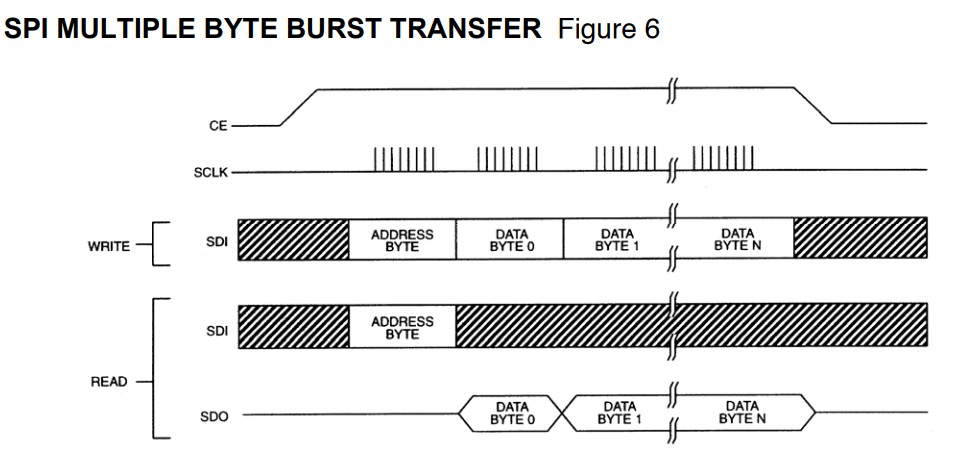
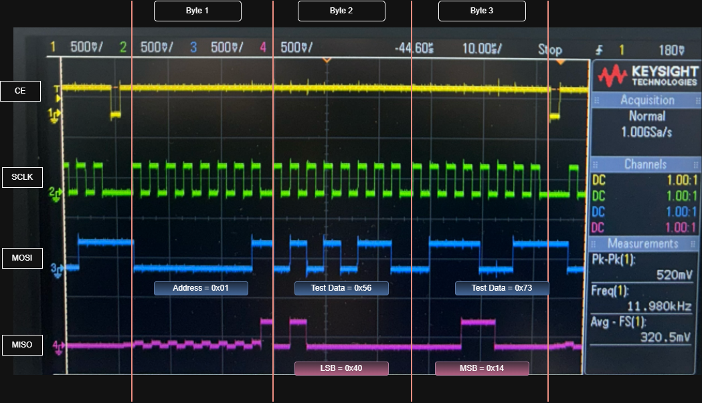
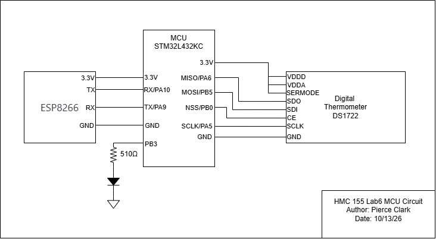
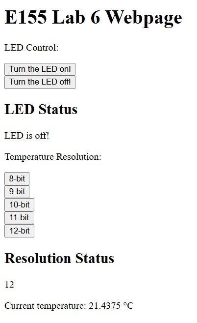
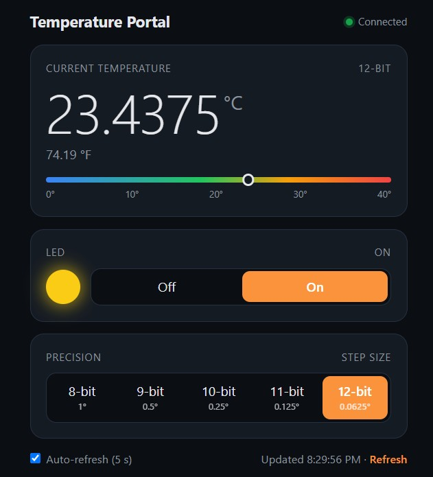

## Introduction

In lab 6, the STM32L432KC microcontroller was configured to use its built-in serial peripheral interface to communicate with a DS1722 Digital Thermometer. The microcontroller also communicated with an ESP8266 32-bit Wi-Fi micro-controller chip over UART. The ESP8266 displayed html code that allowed users to change the state of an LED on the board, and change the resolution of the temperature measurement.

This lab developed skills regarding configuring serial protocols. It also built on the skill of writing register-level drivers for microcontrollers.

## Design

The SPI1 peripheral was configured to communicate with the DS1722 in full-duplex mode. This configuration uses four wires (CE, MISO, MOSI, SCLK).

The system clock on the microcontroller was set to PLL of 80 MHz. SPI1 is clocked from the APB2 bus, which was left at its default prescaler of 1, so $f_{PCLK2} = 80$ MHz. The SPI clock is divided down from this by the baud rate control bits (BR) in SPI1_CR1:

$$
f_{SCLK} = \frac{f_{PCLK2}}{2^{BR+1}}
$$

With a baud rate setting of BR = 7 (0b111), the frequency of the SPI clock is

$$
f_{SCLK} = \frac{80\text{ MHz}}{2^{7+1}} = \frac{80\text{ MHz}}{256} = 312.5\text{ kHz}
$$

This is well below the DS1722's maximum SCLK frequency of 5 MHz.

The PB3 pin was connected by GPIO to the LED.
Pins PA9 and PA10 were used for the UART interface. I was provided pre-written drivers. The only important thing I had to do was to connect the MCU's TX to the ESP8266's RX, and vice versa.

## Testing Methodology

Before flashing the MCU or connecting to the temperature or wifi sensors, the code was debugged in Segger Embedded Studio. I loaded the drivers and packages for my STM32L432KC MCU, and made sure the code was compiling and had no syntax errors. The SPI functionality was confirmed using an oscilloscope.

### Oscilloscope

The ideal SPI protocol is described in the [DS1722 datasheet](images/ds1722.pdf), shown below.



To read from the temperature sensor, the address and data bytes are shifted MSB first into the serial data input (SDI) and out of the serial data output (SDO). As per the datasheet, any transfer requires the address of the byte to specify a write or a read, followed by one or more bytes of data. The temperature measurement is 2 bytes, meaning we will use a 3-byte burst to read 2 bytes from the address provided in the first byte. To read the temperature, we set the address to 0x01.



The SPI functionality was verified using an oscilloscope to measure all 4 wires. The waveforms confirm that the SPI setup is performing as expected. CE begins by going high. In the first byte, the MCU sends the address 0x01 on MOSI. In the second and third bytes, the MCU sends test data 0x56 and 0x73. The DS1722 shifts out the temperature on MISO, giving us the LSB (0x40), then MSB (0x14). This gives a reading of 0x1440, or 20.25 °C (68.45°F), which is a reasonable room temperature.

## Technical Documentation

The source code for the project can be found in the associated [GitHub repository](https://github.com/pclarkhmc/e155).

### Schematic



The STM32L432KC connects to the DS1722 over SPI1 (SCLK on PA5, MISO on PA6, MOSI on PB5, CE on PB0), to the ESP8266 over UART (TX on PA9, RX on PA10), and drives the LED on PB3 through a 510 Ω resistor.

## Results and Discussion

All requirements for the lab were met. The temperature sensor accurately displayed the temperature on the website. Input from the website was able to change the floating point resolution of the measurement.

### Website



The webpage served by the ESP8266 is shown above. Users can turn the LED on or off and select a temperature resolution from 8 to 12 bits. The page displays the current LED status, the selected resolution, and the temperature read from the DS1722.

### Shortcomings

In terms of shortcomings, the reference manual for the SPI is difficult to understand. I would say I understand SPI to a high degree; however, I would likely benefit by creating a system that customizes the SPI configuration more, such as a multi-master or one-way communication system. 

## Conclusion

In conclusion, in lab 6, SPI was used to interface with a temperature sensor. UART was used to send website info to an ESP8266. This allows people connected to the ESP8266's wifi network to monitor the temperature sensor's output with varying amounts of resolution.

In total, I spent ~13 hours on this lab.

## Lab 6 AI Prototype

### Model

I used Claude Opus 5.5 at High effort

### Frontend Prompt

```
I’m making a web portal to interface with a temperature sensor. Create a HTML page that looks good and is intuitive to show the temperature, control an LED, and change the precision of the readout.
```

#### Process

I used Claude Code to make a branch of my code and integrate the HTML into the existing codebase.

#### Results

The AI-generated webpage is shown in @fig-ai-website. Compared to my webpage in the Website section, it displays the temperature in both °C and °F with a color scale, uses a toggle for the LED with an indicator light, and labels each precision setting with its step size. It also adds a connection indicator and an auto-refresh option that updates the reading every 5 seconds.

{#fig-ai-website}

### Embedded Prompt

```
Write me a C function to carry out a SPI transaction to retrieve a temperature reading from a DS1722 sensor. Use CMSIS libraries for the STM32L432KC.
```

#### Process

The code looks like it works, I loaded the AI prototype branch with the drivers integrated, and the website ran just like before. This indicates the drivers are functioning correctly. 

#### Results

```
uint8_t ds1722ReadReg(uint8_t addr) {
    ceHigh();
    shortDelay();
    spiXfer(addr & 0x7F);              // address byte, A7 = 0 for read
    uint8_t val = spiXfer(0x00);       // dummy byte clocks the data out
    while (SPI1->SR & SPI_SR_BSY);     // let the last clock finish before dropping CE
    ceLow();
    shortDelay();
    return val;
}
```

### Comparison

The LLM generated frontend web code better than low-level embedded C. I would say that for C, it might overcomplicate the drivers trying to make them more safe. For the application, I think my driver was more readable than the AI's.

### Reflection

I would rate the output quality very high. The generated code, although it functions identically, provides a much better UI, and a clean device driver. The LLM's explanation of the driver was quite limited, but it left a fair amount of documentation in the driver that helps a lot.
