## Introduction

AES-128 is an encryption algorithm that scrambles a 128-bit block of data using a 128-bit key over 10 rounds. Starting from the initial key, the key expansion algorithm generates 10 round keys. During each round, the cipher goes through four main steps, SubBytes, ShiftRows, MixColumns, and AddRoundKey, using a new round key each round. See the [FIPS-197 specification](https://nvlpubs.nist.gov/nistpubs/FIPS/NIST.FIPS.197-upd1.pdf) for full details. The whole algorithm can be written as:

$$
\text{AES-128}(in, key) = \text{CIPHER}(in, 10, \text{KEYEXPANSION}(key))
$$

The design of this system is fairly simple. The MCU sends the plaintext and key to the FPGA over SPI (see [Lab 6](../lab6/lab6.qmd)). The FPGA encrypts the plaintext and raises a done flag that tells the MCU to read back the ciphertext. The MCU checks that the ciphertext is correct and then turns on the LED at PA9.

AES is a good fit for hardware because most of its steps are byte shuffles and XORs across the whole 128-bit block. On the MCU, each of those is a separate instruction. On the FPGA, ShiftRows, MixColumns, and AddRoundKey are wiring and XOR gates that all finish in the same clock cycle.

In this lab, I continued developing my SystemVerilog skills. Designing the FSMs and datapaths was a great challenge. I also learned how to use on-chip memory and how to interface between the MCU and FPGA. Confirming that each part behaved correctly took a lot of testbenches.

### Cipher()

The cipher starts with an AddRoundKey, runs 9 full rounds, and ends with a round that skips MixColumns (FIPS-197, Section 5.1).

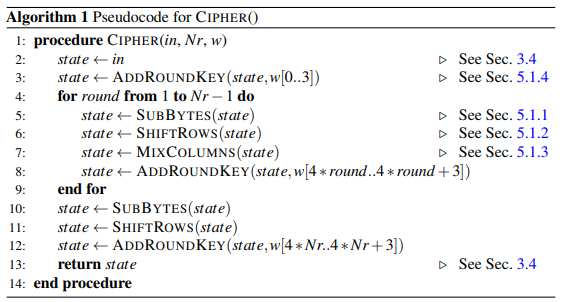{#fig-cipher-pseudocode}

The state is one 128-bit register that updates once per round. A mux picks the plaintext in round 0, skips MixColumns in round 10, and takes the full round otherwise.

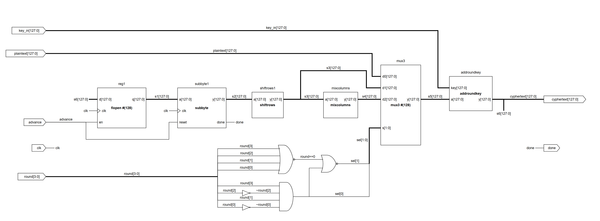{#fig-cipher-core-block}

SubBytes swaps each byte for its S-box value. I feed the bytes through one S-box in EBR one at a time, so it takes about 18 cycles. The result is put into a shift register.

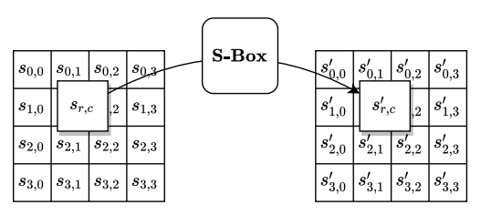{#fig-subbyte}

Due to a misunderstanding, I thought the iCE40 only had 4 EBRs. It actually has 30 EBRs and 4 SRAMs. This made it substantially harder to work around because I had to feed in bytes sequentially to the S-box. It is also MUCH slower, but still faster than doing it on the MCU.

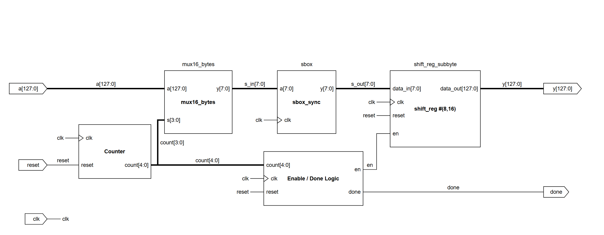{#fig-subbyte-block}

ShiftRows is just wiring. MixColumns multiplies each column by a fixed matrix in $GF(2^8)$, which simplifies down to XORs and a left shift, XORed with 0x1B if the top bit was set. AddRoundKey XORs the state with the round key.


### Keyexpansion()

> KEYEXPANSION() is a routine that is applied to the key to generate 4 ∗ (Nr + 1) words. (FIPS-197, Section 5.2)

For AES-128, that is 11 round keys. 1 initial key, 10 generated keys.

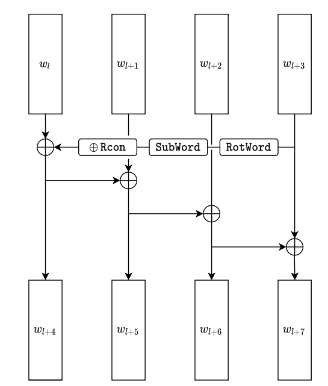{#fig-keyexpansion}

Each round key is built from the last one using RotWord, SubWord, Rcon, and a chain of XORs.

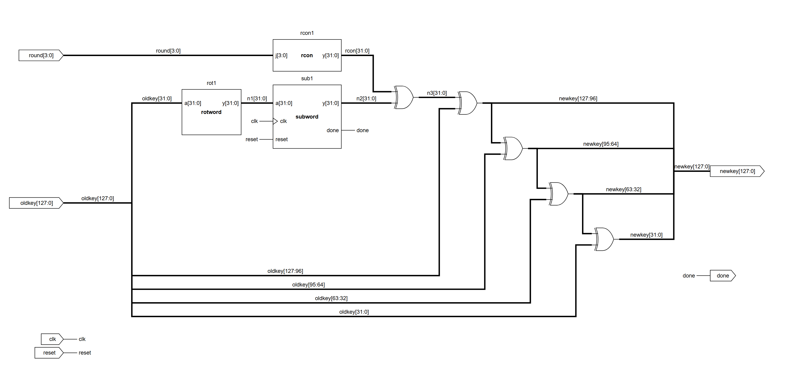{#fig-keyexpansion-block}

Keys are computed one round at a time, so only one is stored. The S-box lives in an EBR, which adds a cycle per lookup. The controller loads the key in round 0, then enable the key flip flop to store it when the round changes.

### Implementing AES Algorithm

The top level module connects the SPI interface to the AES core, which runs at 24 MHz driven by the high speed oscillator. The clock speed had to be reduced from 48 MHz due to a long critical path.

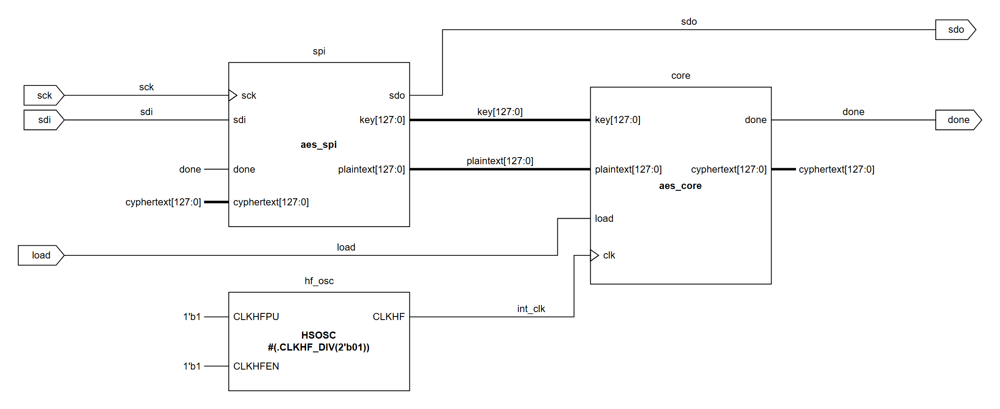{#fig-aes-block}

The controller counts rounds and steps the cipher and key expansion forward. When the last round finishes, it raises done so the MCU knows to read back the ciphertext.

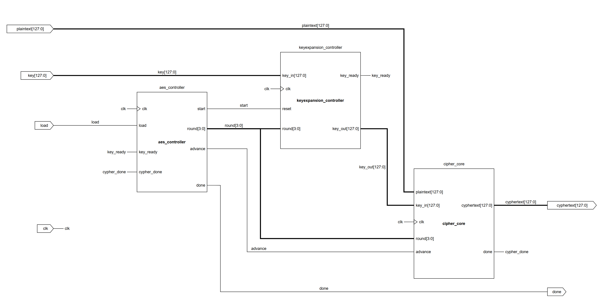{#fig-aes-core-block}

Sharing one S-box keeps the size at 2 EBRs and 30% of the LUTs. Each round is around 18 cycles. This design could be much faster if I had known there were 30 EBRs available, hypothetically taking around 3 cycles per round rather than 18.

### Simulation

Both testbenches use the cipher example from FIPS-197 Appendix B.

The core testbench feeds the key and plaintext straight into the AES core. This testbench passed, and the round keys in the waves match FIPS-197 Appendix A.1.

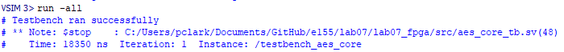{#fig-aes-core-results}

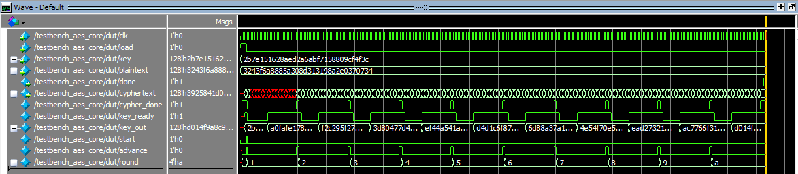{#fig-aes-core-waves}

The AES_SPI testbench runs the whole system. It shifts the key and plaintext in over SPI and the ciphertext back out.

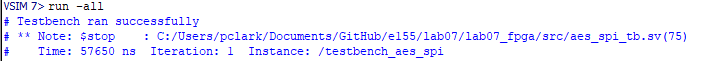{#fig-aes-spi-results}

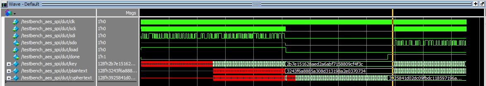{#fig-aes-spi-waves}

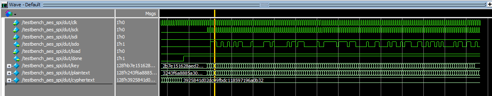{#fig-aes-spi-waves-closeup}

## Results and Discussion

The design worked on the hardware. The MCU read back the correct ciphertext and turned on the LED at PA9.

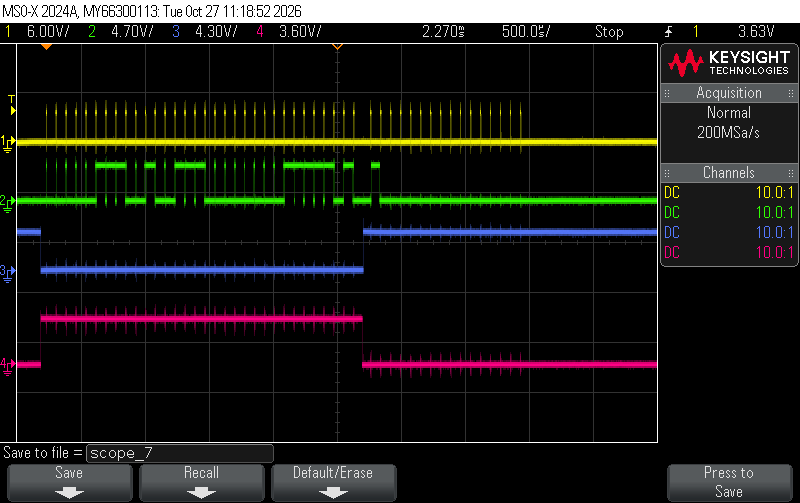{#fig-spi-load-done}

The core finishes 7.6 µs after LOAD falls. At 24 MHz that is about 182 cycles, which matches the roughly 18 cycles per round from the design.

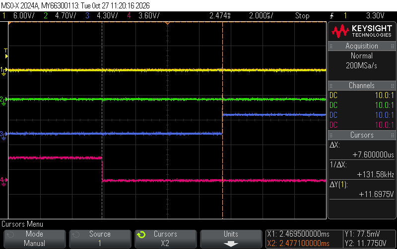{#fig-spi-ttf}

The SPI transfer itself takes a few milliseconds, so the encryption is a very small part of the total time.

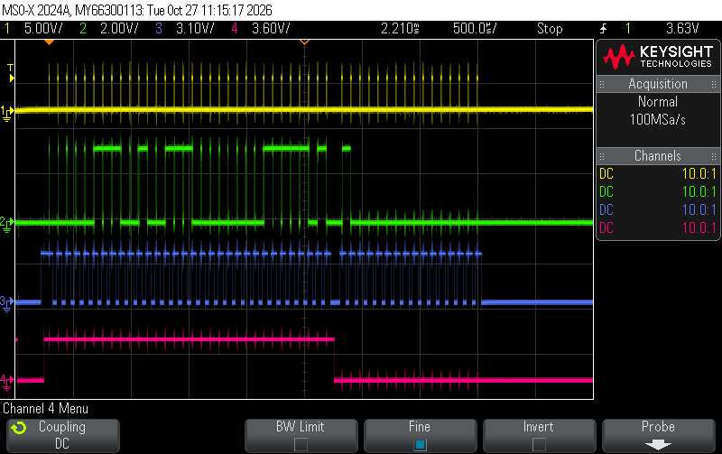{#fig-scope-5}

### Full SPI transaction

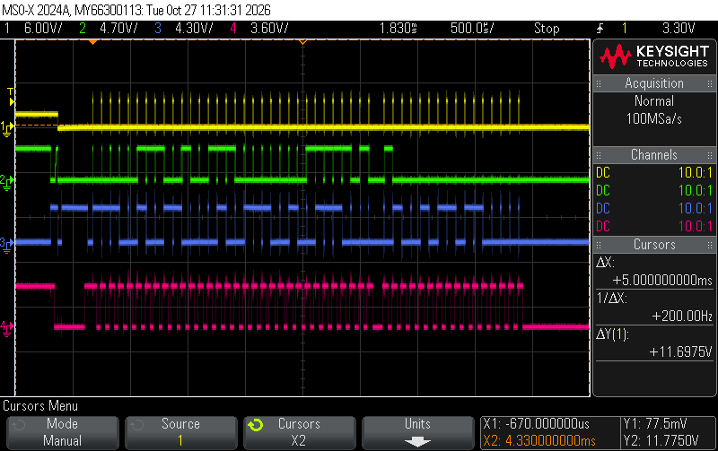{#fig-spi-full}

### Shortcomings

SubBytes is the slowest part, taking 16 of the 18 cycles in each round. Using more EBRs would cut that down, but since the full SPI transaction takes milliseconds, a faster core would barely change the total time.

## Conclusion

In Lab 7, an AES accelerator was built and interfaced with the MCU. The AES core completed a full encryption in 7.6 µs. The design was successfully ported to real hardware and completed a real transaction.

Hours spent on the lab: 15-20

## Lab 7 AI Prototype

### Model

Claude Opus 5.5 in Claude Code at default effort. Each prompt ran in a fresh subagent with no shared history.

### Prompt 1: with the spec

```
Write SystemVerilog HDL to implement the KeyExpansion logic described in the FIPS-197 uploaded document. The module should be purely combinational, using the previous key and current round number to calculate the next key. Assume other required modules (SubWord and RotWord) are already implemented.
```

<details>
<summary>Show generated code</summary>

```verilog
// keyexpansion.sv
// Combinational AES-128 key expansion step (FIPS-197 Sec. 5.2, Alg. 2, Fig. 6).
// Given round key (round-1), produce round key (round).
//   round = 1  : prev_key is the cipher key, next_key is round key 1
//   round = 10 : next_key is the final round key
module keyexpansion (
    input  logic [127:0] prev_key,   // {w[4r-4], w[4r-3], w[4r-2], w[4r-1]}
    input  logic [3:0]   round,      // r, the round whose key is being generated (1..10)
    output logic [127:0] next_key    // {w[4r],   w[4r+1], w[4r+2], w[4r+3]}
);

    // Split the previous round key into its four 32-bit words.
    // Word 0 is the most significant (holds key bytes 0..3), per Sec. 3.
    logic [31:0] w0, w1, w2, w3;
    assign {w0, w1, w2, w3} = prev_key;

    // temp <- SubWord(RotWord(w[i-1])) xor Rcon[i/Nk]   (Alg. 2, line 10)
    logic [31:0] rotated, substituted, rcon, temp;

    rotword u_rotword (.a(w3),      .y(rotated));
    subword u_subword (.a(rotated), .y(substituted));

    // Round constants, Table 5: Rcon[j] = [x^(j-1), 00, 00, 00]
    always_comb begin
        case (round)
            4'd1:    rcon = 32'h01_00_00_00;
            4'd2:    rcon = 32'h02_00_00_00;
            4'd3:    rcon = 32'h04_00_00_00;
            4'd4:    rcon = 32'h08_00_00_00;
            4'd5:    rcon = 32'h10_00_00_00;
            4'd6:    rcon = 32'h20_00_00_00;
            4'd7:    rcon = 32'h40_00_00_00;
            4'd8:    rcon = 32'h80_00_00_00;
            4'd9:    rcon = 32'h1b_00_00_00;
            4'd10:   rcon = 32'h36_00_00_00;
            default: rcon = 32'h00_00_00_00;  // round 0 / 11-15 unused
        endcase
    end

    assign temp = substituted ^ rcon;

    // w[i] <- w[i-Nk] xor temp, where temp = w[i-1] for i mod 4 != 0  (Alg. 2, line 14)
    logic [31:0] n0, n1, n2, n3;
    assign n0 = w0 ^ temp;   // i mod 4 == 0
    assign n1 = w1 ^ n0;
    assign n2 = w2 ^ n1;
    assign n3 = w3 ^ n2;

    assign next_key = {n0, n1, n2, n3};

endmodule
```

</details>

The AI's own testbench passed, and all 10 round keys matched FIPS-197 Appendix A.1. It synthesized on the first try.

### Prompt 2: without the spec

```
Write SystemVerilog HDL to implement the following logic:

i = 0
while i < Nk do
    w[i] <- key[4*i..4*i+3]
    i <- i+1
end while
while i <= 4 * Nr + 3 do
    temp <- w[i-1]
    if i mod Nk = 0 then
        temp <- module1(module2(temp)) (+) Rcon[i/Nk]
    else if Nk > 6 and i mod Nk = 4 then
        temp <- module1(temp)
    end if
    w[i] <- w[i-Nk] (+) temp
    i <- i + 1
end while
return w

Assume module1 and module2 are existing modules that can be instantiated. (+) refers to XOR. Unwrap the loop in the provided pseudo code so it uses the previous iterations output to generate the new iteration.

Do not use any existing knowledge of the AES specifications in your answer.
```

<details>
<summary>Show generated code</summary>

```verilog
// Unrolled implementation of the word-expansion loop.
//
//   Nk : number of 32-bit words supplied by the key
//   Nr : sets the output length -> words w[0] .. w[4*Nr+3]
//
// key  : byte array, key[0] .. key[4*Nk-1]
// rcon : lookup table indexed by i/Nk (supplied externally)
// w    : expanded word array, w[0] .. w[4*Nr+3]
module word_expand #(
  parameter int Nk = 4,
  parameter int Nr = 10
)(
  input  logic [7:0]  key  [0:4*Nk-1],
  input  logic [31:0] rcon [0:(4*Nr+3)/Nk],
  output logic [31:0] w    [0:4*Nr+3]
);

  genvar i;
  generate
    // ------------------------------------------------------------
    // First loop:  w[i] <- key[4*i .. 4*i+3]   for i = 0 .. Nk-1
    // ------------------------------------------------------------
    for (i = 0; i < Nk; i++) begin : g_init
      assign w[i] = {key[4*i], key[4*i+1], key[4*i+2], key[4*i+3]};
    end

    // ------------------------------------------------------------
    // Second loop, unrolled: i = Nk .. 4*Nr+3
    // Each stage uses the previous stage's output w[i-1]
    // and the earlier word w[i-Nk].
    // ------------------------------------------------------------
    for (i = Nk; i <= 4*Nr+3; i++) begin : g_expand
      logic [31:0] temp_in;   // temp <- w[i-1]
      logic [31:0] temp;      // temp after the conditional processing

      assign temp_in = w[i-1];

      if (i % Nk == 0) begin : g_case_mod0
        // temp <- module1(module2(temp)) XOR Rcon[i/Nk]
        logic [31:0] m2_out, m1_out;

        module2 u_module2 (.in(temp_in), .out(m2_out));
        module1 u_module1 (.in(m2_out),  .out(m1_out));

        assign temp = m1_out ^ rcon[i/Nk];
      end
      else if ((Nk > 6) && (i % Nk == 4)) begin : g_case_mod4
        // temp <- module1(temp)
        logic [31:0] m1_out;

        module1 u_module1 (.in(temp_in), .out(m1_out));

        assign temp = m1_out;
      end
      else begin : g_case_pass
        // temp unchanged
        assign temp = temp_in;
      end

      // w[i] <- w[i-Nk] XOR temp
      assign w[i] = w[i-Nk] ^ temp;
    end
  endgenerate

endmodule
```

</details>

Instead of a one-round module, it unrolled the whole key schedule. All 44 words matched Appendix A.1. It never mentioned AES.

Both open-source tools had trouble with the unpacked-array ports. Icarus read every output as `x` in the testbench, so I read `dut2.w` directly. Yosys wouldn't parse the file:

```
word_expand.sv:13: ERROR: syntax error, unexpected '[', expecting ',' or '=' or ')'
```

I made a copy with packed ports for synthesis. The logic is unchanged.

### Simulation

```
Prompt 1 (with spec):    10/10 round keys correct
Prompt 2 (without spec): 44/44 words correct
```

### Comparison

| Design | Does | S-boxes | LUT4 | FFs | EBR |
|---|---|---|---|---|---|
| Prompt 1 | next key from previous key | 4 | 1,375 | 0 | 0 |
| Prompt 2 | all 10 rounds at once | 40 | 14,625 | 0 | 0 |
| Mine | next key from previous key | 1 (EBR) | 166 | 37 | 1 |

Prompt 1 is nearly the same as my module. Its SubWord has no clock, though, so it wouldn't drop into my design as is.

Prompt 2 is correct but almost three times too big for the UP5K (5,280 LUTs). It also builds the `Nk > 6` branch, which AES-128 never uses.

Code and full AI responses are in `E155-Labs/lab07/AI_Prototype`.

### Reflection

The syntax the LLM's use is complex and full of bloated comment. I would rate the output quality high however since it did a nice job of using parameters to make a unrolled version of the algorithm. I'm not that familiar with generate blocks, but it was fairly readable because of the clear variable names that related to the spec.
If I were to implement AI into my workflow, I would have it making tests primarily, because I think I can efficiently allocate resources for my board based on my knowledge of the FPGA.