```{=html}
<div style="position:relative;width:100%;height:clamp(440px,62vw,600px);border-radius:18px;overflow:hidden;background:#050507;margin:0 0 0.5rem">
  <iframe src="chip3d/index.html" title="Interactive 3D model of the processor die" loading="lazy" allowfullscreen
          style="position:absolute;inset:0;width:100%;height:100%;border:0"></iframe>
</div>
```

*The processor as a physical chip. Drag to rotate, or switch to "Up close" to see transistors and the metal stack in 3D. See [Physical Layout](#physical-layout) for how it was made.*

## Introduction

For the 2026 System-on-Chip Design (E154) final project, my partner Max Conine and I turned a single-cycle RISC-V processor into a pipelined one. We then optimized it by shortening the critical path, reducing hazard penalties, and cutting area. The final processor scored over ten times the original's figure of merit and ran CoreMark 62.4% faster.

The project gave us experience with the full SoC development loop: microarchitecture design, RTL in SystemVerilog, verification against compliance tests and benchmarks, and iterating on synthesis results.

The full [project report](images/SOCFinalReport.pdf) and [final presentation](images/SOCFinalPresentation.pdf) are available as PDFs.

## Microarchitecture

The processor uses a 5-stage pipeline implementing the RV32IM instruction set, with a dedicated 3-stage multiply unit and a hazard unit that handles forwarding, stalls, and flushes. The design is based on the pipelined processor from *Digital Design and Computer Architecture, RISC-V Edition* by David and Sarah Harris, and on the [CORE-V Wally](https://github.com/openhwgroup/cvw) RISC-V processor.

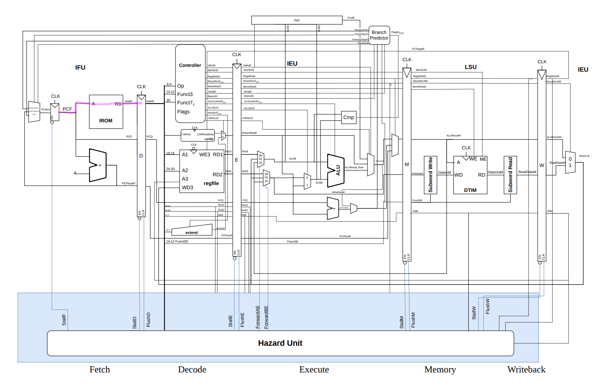{#fig-top-level}

### Implemented Extensions

**RV32I.** The base 32-bit integer instruction set provides everything a general-purpose computer needs:

- Integer arithmetic: ADD, SUB, AND, OR, XOR, and shifts
- Loads and stores of bytes, halfwords, and words
- Conditional branches (BEQ, BNE, BLT, BGE, BLTU, BGEU) and jumps (JAL, JALR)
- Set-less-than (SLT, SLTU)
- Immediate operations (ADDI, ANDI, etc.)

**Zmmul.** The multiplication subset of the M extension, without division or remainder:

- MUL: lower 32 bits of the product
- MULH: upper 32 bits, signed × signed
- MULHSU: upper 32 bits, signed × unsigned
- MULHU: upper 32 bits, unsigned × unsigned

Hardware multiplication removes the software loops that RV32I would otherwise need, which cuts the number of instructions considerably.

**Zicsr and Zicntr.** These let software read the cycle and instructions-retired counters in the control and status register (CSR) file, which CoreMark uses to compute its score.

## Figure of Merit

Processors were scored with a figure of merit provided by the course staff, which weights execution time much more heavily than area:

$$
\text{Score} = \frac{10^{30}}{(\text{cycles} \times t_{clk})^3 \times \text{Area}}
$$

where cycles is the CoreMark cycle count, $t_{clk}$ is the critical path length in ns, and Area is the total cell area in µm². Our priorities followed the weighting: first clock period through pipelining, then cycle count through branch prediction, then area through architectural cleanup.

## Processor Optimizations

### Pipelining

The five stages are Fetch, Decode, Execute, Memory, and Writeback. Splitting each instruction across stages shortens the critical path and lets several instructions execute concurrently. Our first pipelined version cut the single-cycle processor's 8.24 ns critical path to 5.10 ns. We considered a sixth stage, but the 3 ns instruction and data memories put a floor on the clock period, so the extra stage would not have paid off.

### Multiply Unit

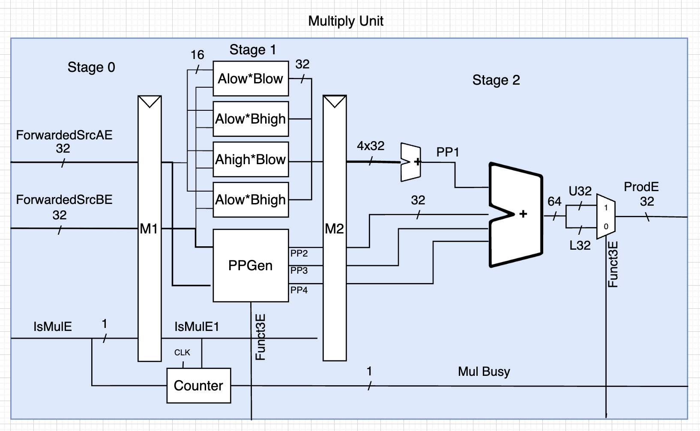{#fig-mul}

The multiply unit (@fig-mul) is a modified version of the Wally multiplier. In the first stage, it computes the four pieces of partial product PP1 with four 16×16 multiplications, along with the sign-correction partial products PP2 through PP4. In the second stage, the four pieces are summed into PP1, all four partial products are added into a 64-bit result, and the upper or lower half is selected based on the instruction.

The M1 register keeps the partial product calculation off the critical path. This adds two cycles to every multiply, but the shorter critical path more than makes up for it. When a multiply enters Execute, a counter waits two cycles and then resets. While the unit is busy, the rest of the pipeline stalls, which keeps the existing hazard logic correct.

```systemverilog
// Four 16x16 multiplies — true HALF x HALF critical path
assign PP1E_ll = Aprime_lo * Bprime_lo;
assign PP1E_lh = Aprime_lo * Bprime_hi;
assign PP1E_hl = Aprime_hi * Bprime_lo;
assign PP1E_hh = Aprime_hi * Bprime_hi;
```

### Branch Logic

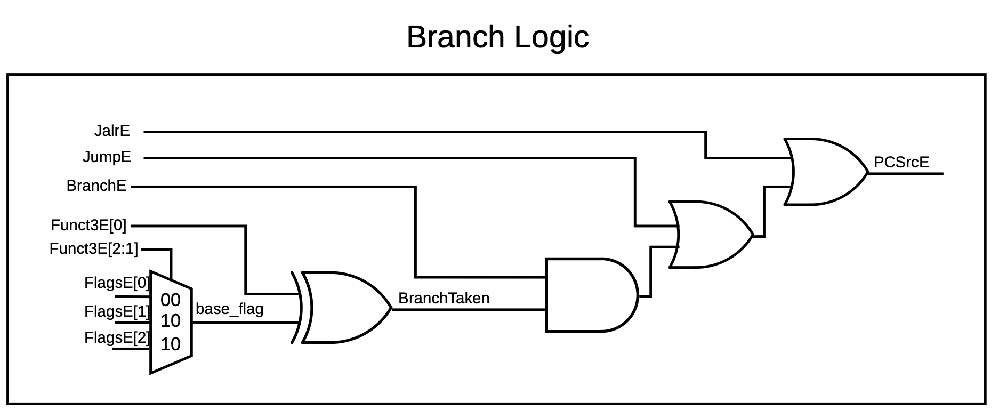{#fig-branch-logic}

The branch logic decides whether the next PC is PC+4 or the branch target. Instead of a 6-way multiplexer that evaluates each branch type separately, it takes advantage of how RISC-V encodes funct3: bits [2:1] select the comparison and bit [0] selects its polarity.

| Funct3[2:1] | Base Flag              | Instructions |
|:-----------:|:----------------------:|:------------:|
| 00          | FlagsE[0] (Zero)       | BEQ, BNE     |
| 10          | FlagsE[1] (Less Than)  | BLT, BGE     |
| 11          | FlagsE[2] (Less Than Unsigned) | BLTU, BGEU |

An XOR gate then acts as a conditional inverter. When Funct3E[0] is 0 (e.g., BEQ) the output is the base flag; when it is 1 (e.g., BNE) the output is the inverted flag. This cut the logic from about 60 transistors for a 6-way mux to about 36 for a 3-way mux plus XOR.

```systemverilog
always_comb begin
    case (Funct3E[2:1])
        2'b00: base_flag = FlagsE[0]; // BEQ / BNE
        2'b10: base_flag = FlagsE[1]; // BLT / BGE
        2'b11: base_flag = FlagsE[2]; // BLTU / BGEU
        default: base_flag = 1'b0;
    endcase
end

assign BranchTaken = base_flag ^ Funct3E[0];
```

### Optimized Synthesis

The processor was synthesized with Synopsys Design Compiler on SkyWater SKY130, an open-source 130 nm PDK. Since the memories have a 3 ns access time, the critical path cannot be shorter than 3 ns, so we targeted 333 MHz to land exactly on that limit. With timing effectively capped, we also told the tool to minimize area.

We enabled the `maxopt` flag, which runs the following:

```tcl
if { $maxopt == 1 } {
    ungroup -all -simple_names -flatten
    compile_ultra -retime
    optimize_registers
}
```

- **`ungroup -all -simple_names -flatten`** removes the module hierarchy and flattens the design into a single netlist, so the compiler can optimize across module boundaries.
- **`compile_ultra -retime`** runs the full set of optimizations (datapath optimization, constant propagation, logic restructuring) and lets the compiler move registers across combinational logic to balance path delays.
- **`optimize_registers`** is a second pass focused on register placement: moving registers to reduce setup time, merging redundant ones, and rebalancing pipeline registers across the flattened netlist.

The final synthesis settings were:

```make
SYNTH_MAKE_FLAGS ?= \
    OUTPUTBASEDIR=$(WORK_DIR) \
    NAME=lynn \
    DESIGN=$(SYNTH_TOP) \
    SYNTH_FILES=$(SYNTH_FILES) \
    LIB_FILES=$(LIB_FILES) \
    PROCESSORTOP=$(PROCESSOR_TOP) \
    INCDIR=$(INC_DIR) \
    CONFIG=- \
    MOD=- \
    HDLDIR=$(PROCESSOR_DIR) \
    LYNN=1 \
    TECH=$(SYNTH_TECH) \
    MAXOPT=1 \
    FREQ=333 \
    MAXCORES=4
```

### Minimizing Area

To reduce area we focused on removing registers. A single unoptimized 32-bit register synthesizes to about 1,300 µm², roughly 0.7% of the final processor, so each one removed made a noticeable difference in score.

**Trimming the CSR file.** Our first CSR file kept counters for every instruction class (R-type, jumps, branches, loads, etc.). We removed everything except instructions retired and clock cycles, which shrank the CSR file by about 50,000 µm².

**Merging pipelined signals.** We had been carrying PC+4 and PCTarget all the way to Writeback. Instead, we route them into ALUResult in Execute and let the writeback mux select ALUResult. This removed four 32-bit pipeline registers and shrank the writeback mux. Similarly, CSRReadData and ImmExtD are muxed together in Decode (selected by CSRSrcD) into a single SharedDataE register, which removed another 32-bit register.

**Simplifying the hazard unit.** Removing the `RdE != 0` check from the load-use stall logic (so the processor stalls even when a load writes x0) raised the score by about 1%.

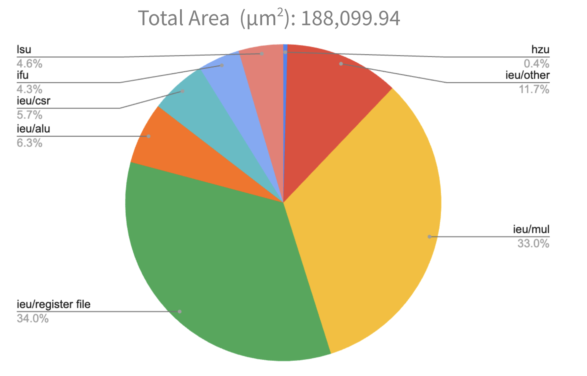{#fig-area}

As @fig-area shows, the register file and multiply unit together make up about two-thirds of the processor's area.

### Hazard Unit

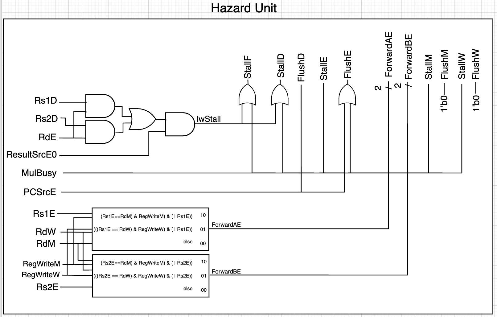{#fig-hazard}

The hazard unit (@fig-hazard) resolves data hazards by forwarding from Memory or Writeback, and stalls for load-use hazards, inserting a bubble into Execute. It flushes Decode when a branch is predicted taken, and flushes both Decode and Execute on a misprediction. We tuned it to stall or flush only when strictly necessary, reducing the total cycle count. While a multiply is in progress, the hazard unit stalls every stage.

```systemverilog
logic lwStall;
assign lwStall = ResultSrcE0 & ((Rs1D == RdE) | (Rs2D == RdE));

assign StallF  = lwStall | MulBusy;
assign StallD  = lwStall | MulBusy;

// Flush Decode if we mispredict in execute OR if we predict taken in decode
assign FlushD  = MispredictE | PredictTakenD;
// Flush Execute if there's a load stall OR if we mispredict in execute
assign FlushE  = lwStall | MispredictE;
```

### Branch Prediction

After the second checkpoint, we added a branch target buffer (BTB) and a 2-bit branch predictor in the Fetch stage to reduce the cycle count.

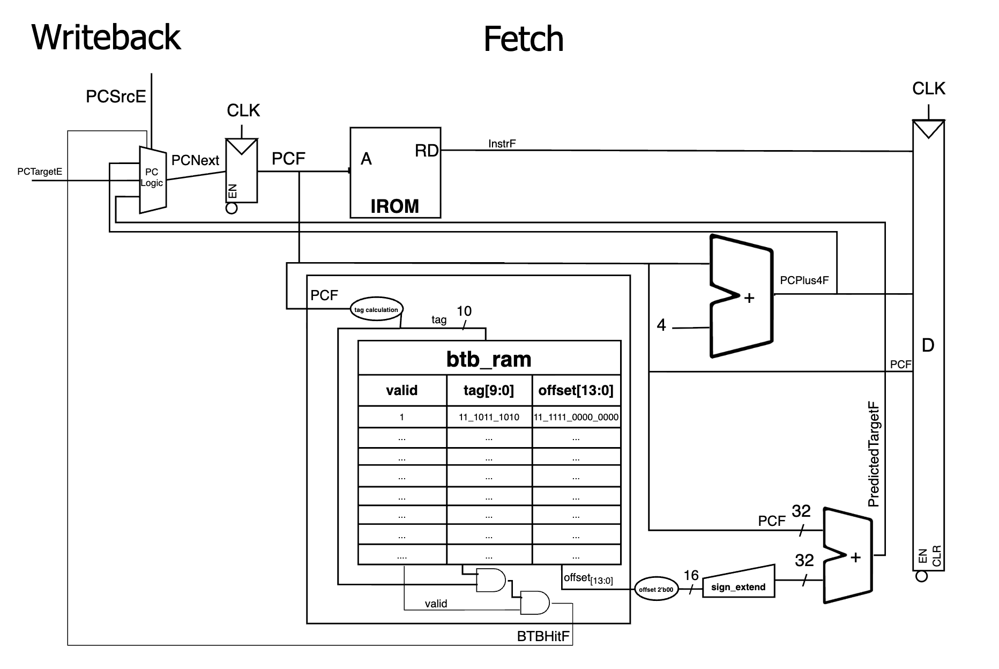{#fig-btb}

The BTB derives a 3-bit index from PCF[4:2] and a 10-bit tag from PCF[14:5]. If the tag matches a valid entry in `btb_ram`, it asserts BTBHitF, and the PC logic selects the predicted target. That target is computed by shifting the stored offset left by two, sign-extending it to 32 bits, and adding it to PCF. We swept the BTB size across several synthesis runs:

| Index Bits  | CoreMark/MHz | Figure of Merit |
|:-----------:|:------------:|:---------------:|
| 2 (4 slots)  | 2.88 | 3,749   |
| 3 (8 slots)  | 2.95 | 4,085.3 |
| 4 (16 slots) | 3.00 | 4,000   |
| 5 (32 slots) | 3.03 | 3,227   |

The BTB raised CoreMark/MHz, but it cost area and timing. With the BTB and 2-bit predictor, the processor grew to 214,931 µm² (the BTB alone was 6.7% of it) and the critical path lengthened to 3.17 ns.

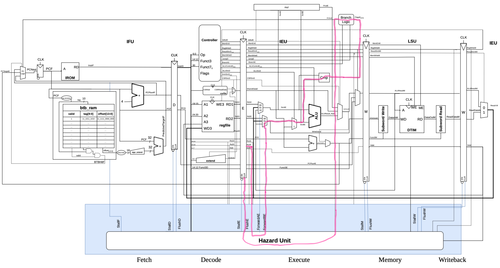{#fig-btb-crit}

As @fig-btb-crit shows, the critical path now ran through the combinational logic that generates FlushE, since it depends on both PredictTakenE and PCSrcE.

Based on this, we designed a predictor with minimal area overhead and no impact on the critical path that still improved CoreMark: **always predict backward branches taken**.

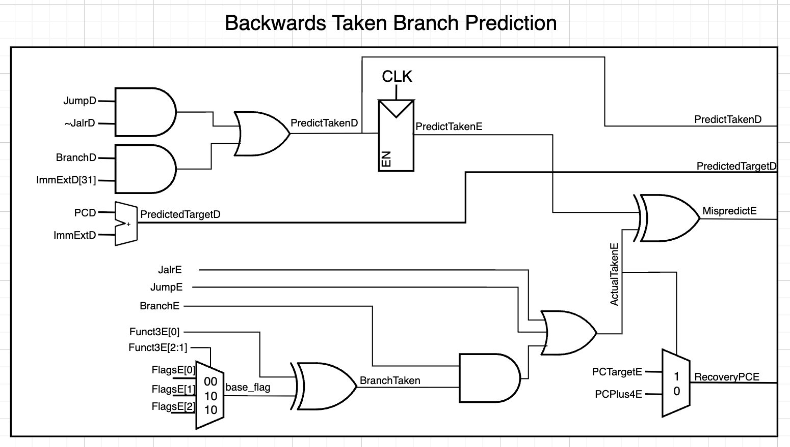{#fig-bpred}

A negative branch offset (ImmExtD[31] = 1) usually indicates a loop, so the predictor (@fig-bpred) predicts taken whenever a branch has a negative offset, and always predicts JAL taken. PCNext is then set to the predicted target. A correctly predicted taken branch costs one cycle; a misprediction costs two. This raised CoreMark/MHz from 2.83 to 2.91 and is the predictor used in the final processor.

```systemverilog
// Predict branches taken if offset is negative (ImmExtD[31]).
// Predict JAL (JumpD & ~JalrD) as always taken.
assign PredictedTargetD = PCD + ImmExtD;
assign PredictTakenD = (BranchD & ImmExtD[31]) | (JumpD & ~JalrD);
```

## Verification

We verified the processor with two suites. The ACT4 architectural compliance tests check that each instruction produces the correct result, and CoreMark shows how the processor handles a real program. We found that ACT4 alone was not thorough enough to catch the pipelining bugs that later showed up in CoreMark.

### ACT4

The final processor passes all 45 ACT4 tests for RV32I, Zicntr, Zihpm, and Zmmul:

```
=== Test Log Summary ===
Total logs:                 45
Passed:                     45
Failed:                     0
Missing 'Completed':        0
Unreadable:                 0
```

### CoreMark

CoreMark runs with zero errors on the final processor, with a CoreMark/MHz score of 2.91 and a CPI of 1.19:

```
WALLY CoreMark Results (from get_time)
  Elapsed MTIME: 3425167
  Elapsed MINSTRET: 2864107
  COREMARK/MHz Score: 10,000,000 / 3425167 = 2.91
  CPI: 3425167 / 2864107 = 1.19
2K performance run parameters for coremark.
CoreMark Size    : 666
Total ticks      : 3425167
Iterations       : 10
Compiler version : GCC15.2.0
INFO: Test Completed!
```

### A Bug ACT4 Missed

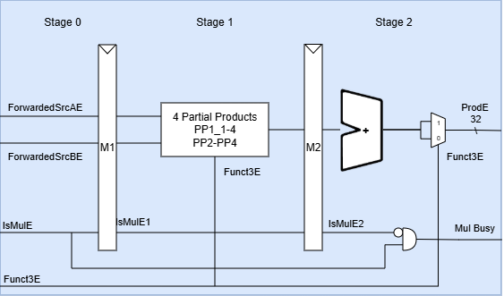{#fig-failing-mul}

At one point the processor passed every ACT4 test but produced wrong results in CoreMark:

```
[0]ERROR! list crc 0xec70 - should be 0xe714
[0]ERROR! matrix crc 0xb9d6 - should be 0x1fd7
[0]ERROR! state crc 0xb215 - should be 0x8e3a
```

The cause was stall logic in an earlier version of the multiply unit (@fig-failing-mul) that failed to stall the second of two back-to-back multiplies. This corner case only exists in a pipelined processor. ACT4 checks that each multiply instruction gives the right answer on its own, but never issues two in a row. It was a hard bug to track down, and a rewarding one to fix.

## Results

::: {.table-responsive}

| Metric | Initial (single-cycle) | Checkpoint 1 | Checkpoint 2 | Final |
|:-------|:----------------------:|:------------:|:------------:|:-----:|
| Figure of Merit | 456.99 | 777.19 (+70.1%) | 4,208.96 (+441.6%) | **4,814.14** (+14.4%) |
| Critical Path (ns) | 8.24 | 5.10 (−38.1%) | 3.02 (−40.8%) | **3.02** (no change) |
| Area (µm²) | 221,069.87 | 282,589.71 (+27.8%) | 196,409.57 (−30.5%) | **188,099.94** (−4.2%) |
| CoreMark/MHz | 3.79 | 3.07 (−19.0%) | 2.83 (−7.8%) | **2.91** (+2.8%) |
| CPI | 1.00 | 1.14 | 1.24 | **1.19** |
| Execution Time (ns) | 27,494,271 | 16,574,458 (−39.7%) | 10,655,015 (−35.7%) | **10,336,281** (−3.0%) |

: Results at each project milestone. Percentages are relative to the previous milestone. {#tbl-results}

:::

Pipelining (Checkpoint 1) and the faster multiplier with optimized synthesis (Checkpoint 2) produced most of the improvement. Branch prediction and area reduction added the final 14%. Pipelining lowers CoreMark/MHz, since stalls and flushes push CPI above 1, but the much shorter clock period more than compensates.

We had projected a figure of merit of 7,190, and the final score of 4,814 fell short. We beat our predicted clock period of 3.86 ns, and our final area came in at about half of our estimate. However, we did not implement any new extensions that would have reduced the cycle count. We also expected to gain by compiling CoreMark more aggressively, but the provided build was already fully optimized.

### Time Breakdown

| Area of Work | Hours |
|:-------------|------:|
| Pipelining | 36 |
| Multiply unit | 15.5 |
| BTB / branch prediction | 12 |
| Final report | 25 |
| **Total (both team members)** | **120.5** |

Our proposal estimated 60–80 hours, based on 5–6 hours per week of pair programming. The actual total of 120.5 hours was well over that estimate.

## Physical Layout

The class flow stops at synthesis, so after the project I took the final RTL through a full place-and-route to see what the processor would look like as a chip. I used the open-source [OpenROAD](https://theopenroad.org/) flow on the same SkyWater SKY130 process: Yosys synthesized the design to 10,580 standard cells, and OpenROAD floorplanned, placed, built the clock tree, and routed every wire. The routed layout was then merged with the real transistor-level layouts of the SKY130 standard cells, so the images below come directly from the chip's mask geometry. The 3D model at the top of this page is built from the same data: the die's surface textures are baked from the mask layers, and the close-up extrudes every polygon in an 18 × 16 µm patch to SKY130's actual layer heights.

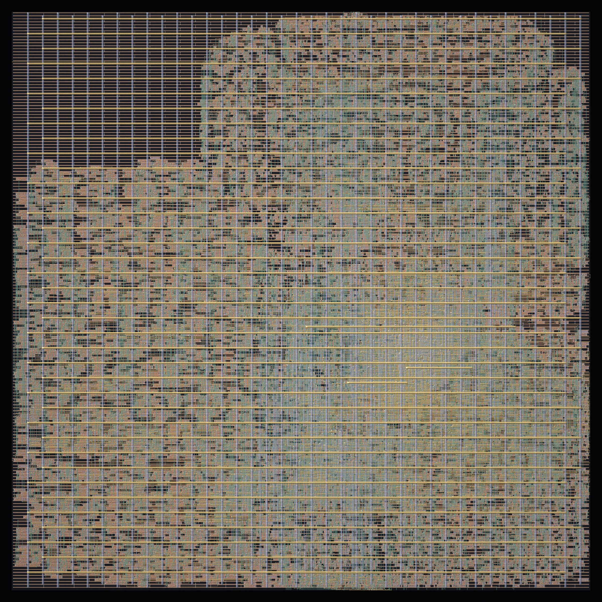{#fig-die}

Zooming in shows the layers underneath. In @fig-die-routing, the signal wiring on metal layers 1 through 3 runs on a fixed grid of tracks beneath the power stripes.

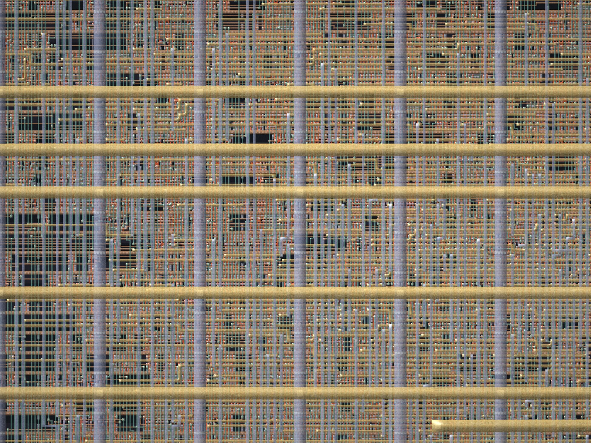{#fig-die-routing}

With the upper metal layers removed (@fig-die-cells), the rows of standard cells appear. The copper bands are the power and ground rails that every cell in a row shares, and the green vertical wires are metal 2 connecting cells across rows.

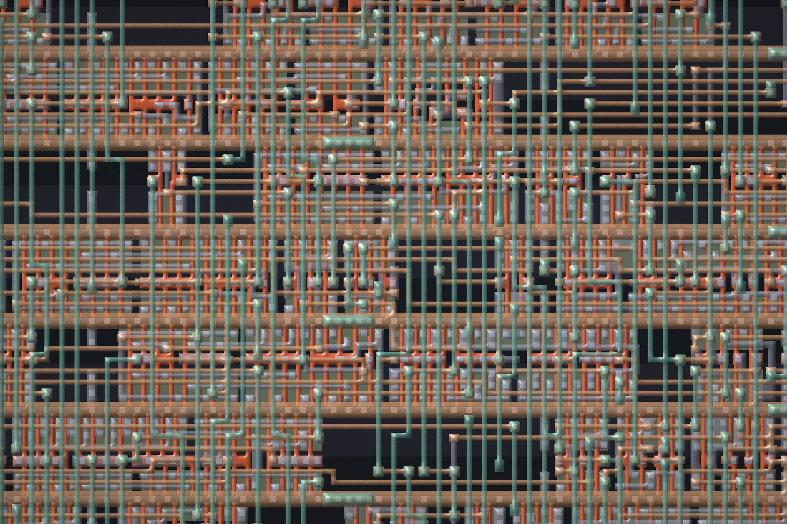{#fig-die-cells}

At the smallest scale (@fig-die-transistors), the individual transistors are visible. Each orange polysilicon line that crosses a green diffusion region is a transistor gate, the gray local interconnect wires transistors together into gates and flip-flops, and the metal 1 wires above connect those cells to each other.

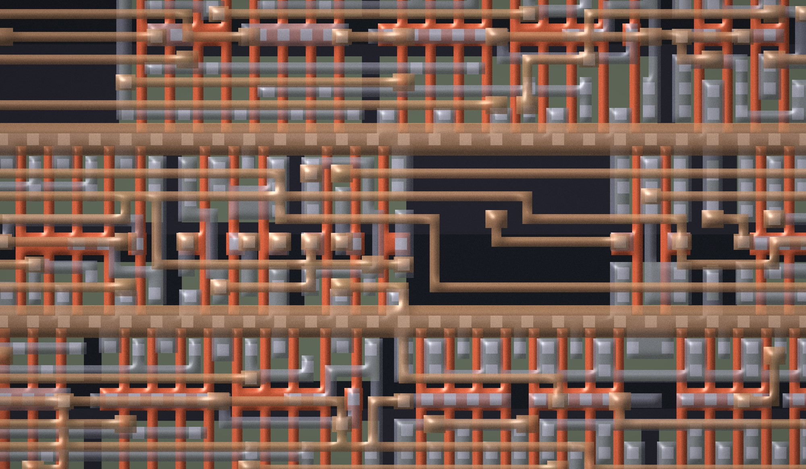{#fig-die-transistors}

The run above synthesizes the design flat: Yosys dissolves every module boundary so it can optimize across them, and afterward nothing in the layout records which cells implement the multiplier and which implement the register file. To see where each block lands, I ran the flow a second time with hierarchical synthesis, which keeps every module intact, and colored each cell by the module it came from (@fig-die-modules, and the "Modules" button in the 3D viewer at the top of the page). The placer was given no floorplan constraints, so these regions come entirely from connectivity. The multiplier and register file are about 60% of the logic, and they settle into the bottom and top of the die. The ALU sits in the middle between them, surrounded by the forwarding muxes and pipeline registers that feed it. Keeping the boundaries costs area, since logic can't be shared or simplified across modules, so Yosys produced 13,038 cells instead of the flat run's 10,580.

{#fig-die-modules}

This layout is an illustration rather than a signoff-quality chip. I capped the detailed router early, so it still has unresolved spacing violations. Yosys also builds the multiplier from ripple-carry adders instead of the fast DesignWare components Design Compiler uses, so this netlist is much slower than our 3.02 ns result, and the tools aren't sizing cells against the same timing target. The timing and area numbers in this report come from Design Compiler.

## Future Improvements

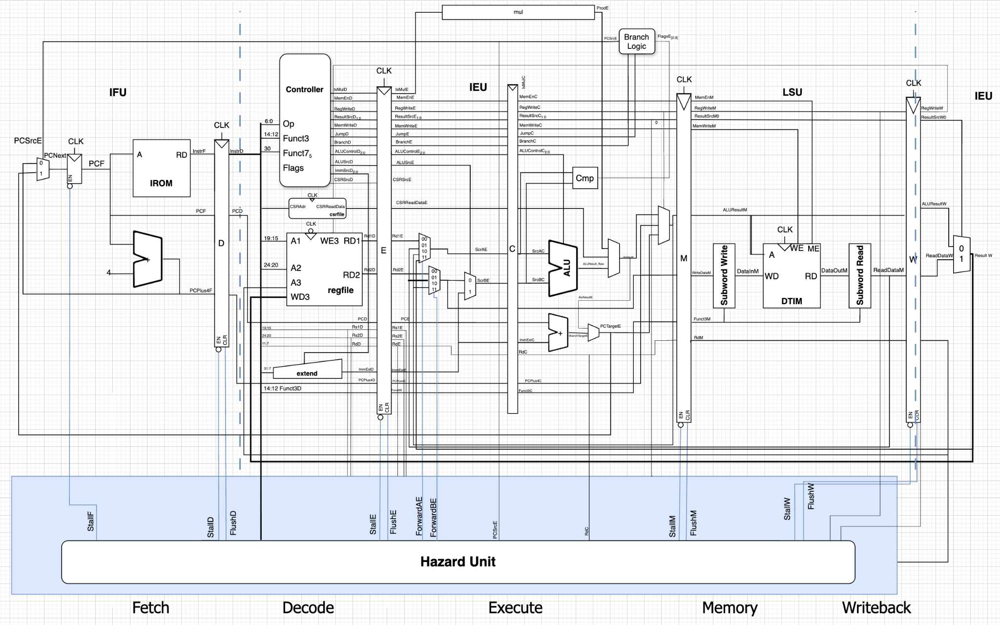{#fig-six-stage}

Our next step would be to split the Execute stage in two (@fig-six-stage). The ALU source-select muxes would sit in the first half, since their inputs arrive from across the processor, which would shorten the critical path and let the multiplier pipeline without stalling.

That second change matters. In an earlier lab, we found that CoreMark executes 173,933 multiplies. Because the processor currently stalls on every multiply, each one adds stall cycles. That costs about 5% of performance compared to the 3,248,907 total cycles we measured without the multi-cycle multiplier.

## Reflection

### Teamwork

Max and I were both genuinely interested in this project, which kept us motivated. We communicated frequently, held design reviews to agree on architectural decisions, worked through implementation details together, and kept a detailed log of progress and goals.

For future projects, we would change two things. First, we would invest more in high-level planning before starting implementation, so we weren't building without a clear plan and could make better architectural decisions up front. Second, we would use our time together more efficiently. Near the end of the project, much of our shared time went to waiting on synthesis runs.

### Use of AI

AI was most useful for debugging and for suggesting synthesis improvements. When wiring units together it is easy to mix up signals, and AI was good at spotting those bugs and checking combinational Verilog before compilation. It was not always right: Copilot's autocomplete sometimes invented signal names while we were connecting modules, and it led us astray while debugging the hazard unit.

We learned to debug on our own first before asking for help, which gave us a better sense of the possible causes. We also found that giving the model a diagram of the processor helped it understand our code and suggest better fixes.

## Source Code

The full source is in the [SOC_Final_Proj repository](https://github.com/SystemOnChipTeam/SOC_Final_Proj). The processor RTL is in [`examples/exercises/lynn/sample_processor/src`](https://github.com/SystemOnChipTeam/SOC_Final_Proj/tree/main/examples/exercises/lynn/sample_processor/src), including the [multiply unit](https://github.com/SystemOnChipTeam/SOC_Final_Proj/blob/main/examples/exercises/lynn/sample_processor/src/submodules/mul.sv), [hazard unit](https://github.com/SystemOnChipTeam/SOC_Final_Proj/blob/main/examples/exercises/lynn/sample_processor/src/hazard.sv), and [integer execution unit](https://github.com/SystemOnChipTeam/SOC_Final_Proj/blob/main/examples/exercises/lynn/sample_processor/src/ieu.sv).
